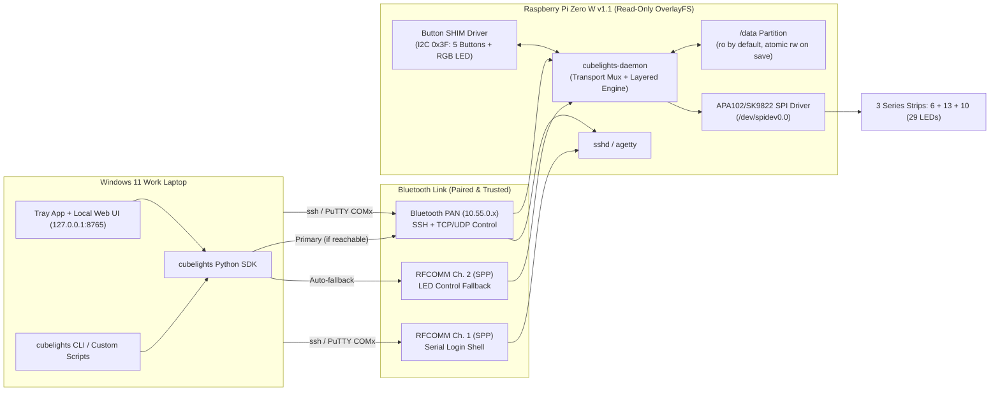

# Cubelights Implementation Plan

## Goal Description
Recreate and modernize the cubicle RGB LED controller on a **Raspberry Pi Zero W v1.1** with a **Maniacal Labs PiPixel HAT**, **Pimoroni Button SHIM**, and **3 series-wired APA102/SK9822 strips (6 + 13 + 10 = 29 LEDs)**.

The system provides:
1. **Corruption-resilient Raspberry Pi OS setup** using read-only root (`OverlayFS`) and a normally-read-only `/data` partition with atomic remount-on-save writes so sudden cubicle power loss cannot corrupt the SD card.
2. **Physical Button SHIM control** with configurable actions, status LED feedback, timed Bluetooth pairing mode, and safe shutdown.
3. **Hybrid Bluetooth connectivity** for a work laptop (Windows 11, no corporate Wi-Fi):
   - **Bluetooth PAN (NAP)** for native `ssh`, `scp`, and IP-based LED control/streaming.
   - **Bluetooth RFCOMM Serial Console** (virtual COM port) as a VPN/policy-proof maintenance shell fallback.
   - **Bluetooth RFCOMM LED Control Channel** speaking the exact same protocol as the IP transport so LED control works regardless of PAN/VPN policies.
4. **Layered, extensible LED engine** supporting:
   - Parameterized built-in shaders (`rainbow`, `pulse`, `wave`, `seasonal`, `solid`, `sparkle`, `chase`, `gradient`) mapped onto configurable 1D/2D segments (`6`, `13`, `10` LED zones with optional reversal and coordinates).
   - Uploadable declarative keyframe/palette animations stored on `/data` that run autonomously on the Pi.
   - Direct individual LED control (static per-LED/zone updates and high-speed binary frame streaming at 30–60 FPS).
5. **Windows 11 client suite** (`cubelights` Python SDK, CLI, system tray app with Busy/On-Call toggle & Windows lock-screen integration, and a local web UI).

---

## User Review Required

> [!IMPORTANT]
> **Hardware & OS Constraints to Verify Before Setup**
> - **OS Image**: Must use **Raspberry Pi OS Lite (32-bit, Debian Bookworm)** — 64-bit images will not boot on the Pi Zero W v1.1 (ARMv6 BCM2835).
> - **PiPixel Jumper**: Confirm the 2x3 jumper on the Maniacal Labs PiPixel HAT is placed on **`SPI_DAT`** (uses `/dev/spidev0.0`, GPIO 10 MOSI + GPIO 11 SCLK).
> - **Color Channel Order**: APA102/SK9822 strips vary by batch (`BGR` vs `RGB` vs `BRG`). We will default to `BGR` and include a quick calibration test command to verify R/G/B order on first run.
> - **OverlayFS Workflow**: Once `OverlayFS` is enabled, any OS/package/code edits made on the Pi over SSH will live in RAM and vanish on reboot unless OverlayFS is temporarily disabled (`sudo raspi-config` or our helper script `cubelights-rw`), updated, and re-enabled. All user presets, patterns, and runtime config live on `/data` and persist across reboots.

---

## Architecture Overview



### Physical Segment Mapping (6 + 13 + 10 = 29 LEDs)
Based on the series-wired strips (6-LED, 13-LED, and 10-LED segments connected by braided 4-wire harnesses), the engine separates **physical index (`0..28`)** from **logical coordinates (`s` along total path, `(x, y)` 2D position, and named `zone`)**:
- `config.json` defines each segment (`length`, `reversed`, `start_xy`, `end_xy`, `name`).
- Animations (`rainbow`, `wave`, `gradient`) evaluate over logical `(x, y)` or normalized path position `u ∈ [0.0, 1.0]`, so waves and rainbows flow seamlessly in the right physical direction regardless of how the braided wires snake between strips.

---

## Proposed Changes

We will structure the repository at `c:\Users\DiddyWolf\Projects\cubelights` as a clean monorepo with three installable/deployable components plus Pi provisioning scripts:

```text
cubelights/
├── shared/                      # Shared protocol, pattern schema, segment mapping (pure Python)
├── pi/                          # Raspberry Pi daemon, hardware drivers, systemd & setup scripts
├── client/                      # Windows 11 Python SDK, CLI, system tray, and local web UI
├── patterns/                    # Example declarative JSON keyframe & seasonal presets
└── tests/                       # Unit & integration tests (hardware mocked, protocol round-trips)
```

---

### 1. Shared Protocol & Pattern Schema (`shared/`)

Pure-Python package (`cubelights_shared`) used identically by both the Pi daemon and the Windows 11 client. Zero external dependencies so it installs cleanly on ARMv6 Pi Zero W and Windows 11.

#### [NEW] [protocol.py](file:///c:/Users/DiddyWolf/Projects/cubelights/shared/cubelights_shared/protocol.py)
Transport-agnostic dual-framing codec supporting mixed control commands and high-FPS live frames on a single stream (TCP or RFCOMM):
- **JSON-line commands** (starts with `{`, terminated by `\n`):
  - `hello` / `status` (capabilities, active mode, brightness, power, uptime, Pi time)
  - `sync_time` (`epoch_ms`, `tz_offset_min` — syncs Pi's software clock / time offset since Pi Zero W lacks an RTC and office Wi-Fi)
  - `set_mode` (`name`, `params`, `persist`)
  - `set_busy` (`enabled`, optional `color`/`speed` override)
  - `set_power` (`on: bool`) & `set_brightness` (`level: 0.0..1.0`)
  - `set_leds` (static direct control: list of `{index, rgb}` or `{zone, rgb}` or full `29` RGB list)
  - `upload_pattern` / `delete_pattern` / `list_patterns` (declarative keyframe animations saved to `/data/patterns/`)
  - `get_config` / `set_segment_map` (update segment lengths, `reversed`, `(x, y)` coordinates)
- **Compact Binary Frame packet** (starts with `0x01`):
  - Header: `0x01` (1B) | `flags` (1B: e.g., hold/timeout behavior) | `brightness` (1B: `0..255`) | `payload_len` (2B uint16)
  - Payload: `29 * 3 = 87` bytes RGB (total **92 bytes/frame**, effortlessly supporting 60 FPS over both PAN and RFCOMM).

#### [NEW] [patterns.py](file:///c:/Users/DiddyWolf/Projects/cubelights/shared/cubelights_shared/patterns.py)
- Declarative keyframe animation schema & validator (Pydantic-free pure Python dataclasses):
  - Supports **keyframes** (`duration_ms`, `easing`: `linear` | `ease_in_out` | `step`, `targets` by LED index, range, or named zone) and `loop` count (`0` = infinite).
  - Supports **palette cycles** (list of RGB stops + flow speed + spatial scale).
- Built-in **segment & 2D coordinate mapper** (`SegmentMap`) translating logical `(x, y)` / normalized `u` / zone names into physical LED indices `0..28`.

---

### 2. Pi Hardware Drivers & Layered LED Engine (`pi/`)

#### [NEW] [apa102.py](file:///c:/Users/DiddyWolf/Projects/cubelights/pi/cubelights_pi/drivers/apa102.py)
- Pure Python `spidev` driver for APA102/SK9822 (`/dev/spidev0.0`, configurable SPI frequency default `4 MHz`, configurable color order default `BGR`).
- Combines 8-bit RGB channels with APA102's 5-bit hardware global brightness (`0xE0 | level`) to keep color fidelity high even at dim desk brightness levels, plus enforces the configured `max_brightness_cap` (default `0.75`).
- Includes a `MockStripDriver` for unit tests and local simulation.

#### [NEW] [button_shim.py](file:///c:/Users/DiddyWolf/Projects/cubelights/pi/cubelights_pi/drivers/button_shim.py)
- Clean, thread-safe driver for the Pimoroni Button SHIM over `/dev/i2c-1` (`0x3F`, TCA9554A I/O expander + bit-banged APA102 status LED) using `smbus2` (avoids legacy `buttonshim` / `RPi.GPIO` Bookworm packaging friction).
- Supports **short press**, **long press** (e.g., 2s for `E`), and **chord press** (`A+E` held 3s for safe `poweroff`).
- Default configurable bindings (`buttons.json` on `/data`):
  - `A`: Next mode
  - `B`: Toggle **Busy / On-Call** override (slow pulsing red; restores previous mode when toggled off)
  - `C`: Cycle brightness steps (`20% → 40% → 60% → 80% → 100%` of safety cap)
  - `D`: Previous mode / cycle seasonal variant
  - `E` (short): Toggle power On/Off (retains active mode)
  - `E` (long 2s): Enable 120s Bluetooth pairing window (SHIM LED pulses blue)
  - `A+E` (long 3s): Safe shutdown (SHIM LED flashes amber/red, syncs `/data`, invokes `systemctl poweroff`)
- SHIM RGB LED status semantics: subtle current-mode tint when active, dim red dot when Busy, pulsing blue during BT pairing, brief white/green blink on BT connect or button ack.

#### [NEW] [engine.py](file:///c:/Users/DiddyWolf/Projects/cubelights/pi/cubelights_pi/engine.py)
- 45–60 FPS render loop with priority layers:
  1. **Stream layer** (live binary frames from laptop; auto-expires after configurable timeout e.g. `5s` if laptop sleeps/disconnects, reverting smoothly to the underlying autonomous mode).
  2. **Static Direct layer** (individual LED/zone values set statically).
  3. **Busy Override layer** (toggled by Button B or laptop `set_busy`).
  4. **Autonomous Mode / Uploaded Pattern layer**:
     - Built-in shaders: `rainbow`, `pulse` (sine/breathing), `wave` (multi-tone oceanic blue waves), `seasonal` (presets: `spring`, `summer`, `fall`, `halloween`, `winter`, `holiday`, plus optional `auto` based on laptop-synced date), `warm_desk`, `sparkle`, `chase`, `gradient`, `solid`.
     - Declarative `KeyframePlayer` running uploaded `/data/patterns/*.json` animations.

#### [NEW] [storage.py](file:///c:/Users/DiddyWolf/Projects/cubelights/pi/cubelights_pi/storage.py)
- Manages `/data` persistence safely under read-only OverlayFS environments:
  - Debounces state changes (`3s` quiet window) before saving `state.json`.
  - Mounts `/data` `rw` -> writes temp file -> `fsync()` -> `os.replace()` -> remounts `/data` `ro` (gracefully falls back to standard directory writes when running in dev/test mode).

---

### 3. Bluetooth Subsystem & Pi Provisioning (`pi/system/`)

#### [NEW] [bt_manager.py](file:///c:/Users/DiddyWolf/Projects/cubelights/pi/cubelights_pi/bt_manager.py)
Runs alongside or inside `cubelights-daemon` via BlueZ D-Bus (`dbus-next` or `dasbus` / `python3-dbus`):
- **Security**: Sets adapter `Discoverable=False`, `Pairable=False` at startup. On `enter_pairing_mode(120s)`, temporarily enables `Discoverable=True`, `Pairable=True`, registers a `NoInputNoOutput` pairing agent, and marks newly paired devices `Trusted=True`.
- **PAN (NAP)**: Registers BlueZ `NetworkServer1` (`"nap"` -> `pan0` bridge), backed by `systemd-networkd` (`10.55.0.1/24`) and `dnsmasq` DHCP (`10.55.0.10–10.55.0.50`).
- **RFCOMM Channel 1 (Maintenance Console)**: Registers BlueZ SPP (`00001101-0000-1000-8000-00805f9b34fb`) on channel 1; on client connect, allocates a PTY and runs `/sbin/agetty` (standard Linux username/password login).
- **RFCOMM Channel 2 (LED Control)**: Registers custom SPP UUID (`e3b0c442-1a2b-4c3d-9e4f-100000000001`) on channel 2, feeding incoming client sockets directly into the `cubelights-daemon` protocol handler (same handler as TCP port `7777` & UDP port `7778`).

#### [NEW] [setup_pi.sh](file:///c:/Users/DiddyWolf/Projects/cubelights/pi/system/setup_pi.sh)
Idempotent provisioning script run via SSH on the fresh **Raspberry Pi OS Lite (32-bit Bookworm)** install:
1. Installs apt dependencies (`python3-venv`, `python3-dbus`, `python3-gi`, `python3-spidev`, `python3-smbus`, `bluez`, `dnsmasq`, `util-linux`).
2. Enables SPI and I2C in `/boot/firmware/config.txt` (`dtparam=spi=on`, `dtparam=i2c_arm=on`).
3. Configures `/etc/bluetooth/main.conf` (Class, FastConnectable, JustWorksRepairing, timeouts).
4. Configures `pan0` bridge (`systemd-networkd`), `dnsmasq` (bound strictly to `pan0` so home Wi-Fi isn't affected), and creates/mounts the `/data` partition (`ro` by default, with sudoers rule allowing `cubelights` service to remount `/data` safely).
5. Installs `cubelights-shared` and `cubelights-pi` into `/opt/cubelights/venv` (using `--system-site-packages` so `python3-dbus` / `python3-gi` work without ARMv6 wheel compilation!) and enables `cubelights.service`.
6. Provides helper scripts `cubelights-enable-ro.sh` (enables OverlayFS after final testing) and `cubelights-rw` / `cubelights-ro` for future maintenance.

---

### 4. Windows 11 Client SDK, CLI, Tray & Web UI (`client/`)

#### [NEW] [transport.py](file:///c:/Users/DiddyWolf/Projects/cubelights/client/cubelights_client/transport.py)
- Smart auto-transport client:
  1. Checks TCP `10.55.0.1:7777` (PAN) with a fast `400ms` connect timeout (and UDP `7778` for frame streaming).
  2. If PAN isn't connected or blocked by corporate VPN, automatically connects via **Classic Bluetooth RFCOMM** to the paired Pi's MAC address on Channel 2 using Python's built-in `socket.AF_BLUETOOTH` (`BTPROTO_RFCOMM`) — or optional Windows `COMx` port via `pyserial`.
  3. Automatically sends `sync_time` on every new connection.

#### [NEW] [sdk.py](file:///c:/Users/DiddyWolf/Projects/cubelights/client/cubelights_client/sdk.py)
- Clean `CubeLightsClient` (sync + async) API:
  - `set_mode(name, **params)`, `set_busy(bool)`, `set_power(bool)`, `set_brightness(float)`
  - `set_leds(colors)` (static per-LED or zone control)
  - `stream_frame(rgb_bytes)` / `FrameStreamer(fps=45)` context manager for custom animated scripts
  - `upload_pattern(pattern)` / `list_patterns()` / `delete_pattern(name)`

#### [NEW] [cli.py](file:///c:/Users/DiddyWolf/Projects/cubelights/client/cubelights_client/cli.py)
- `cubelights` CLI commands:
  - `cubelights discover` (finds paired Pi MAC / PAN IP)
  - `cubelights status` / `cubelights calibrate` (walks R, G, B and segment 1, 2, 3 to verify color order & orientation)
  - `cubelights mode rainbow --speed 0.4` / `cubelights busy on|off` / `cubelights off`
  - `cubelights set-led 0 255 0 0` / `cubelights set-zone top 0 120 255`
  - `cubelights upload patterns/holiday.json`
  - `cubelights tray` / `cubelights ui`

#### [NEW] [tray_and_web.py](file:///c:/Users/DiddyWolf/Projects/cubelights/client/cubelights_client/tray_and_web.py) & [index.html](file:///c:/Users/DiddyWolf/Projects/cubelights/client/cubelights_client/web/index.html)
- **System Tray** (`pystray` + `Pillow`):
  - Quick menu: **Toggle Busy/On-Call**, **Modes** submenu, **Brightness** presets, **Power Off**, **Open Control Panel**.
  - Optional Windows hooks: global hotkey (e.g., `Ctrl+Alt+B` for Busy toggle) and Windows session lock/unlock listener (`WTSRegisterSessionNotification` via `ctypes`) to turn off/dim LEDs when you lock your work laptop and step away!
- **Local Web UI** (`127.0.0.1:8765`, lightweight stdlib/aiohttp server + single-file HTML/JS UI):
  - Live interactive 29-LED visual strip layout matching the 6 / 13 / 10 segment geometry.
  - Mode selector, parameter sliders (speed, brightness, palette), Busy toggle, per-LED static color painter, and JSON keyframe pattern uploader/editor.

---

## Verification Plan

### Automated Tests (Run locally on dev PC via `pytest`)
1. **Protocol & Codec Tests**: Round-trip encode/decode for all JSON commands and compact `0x01` binary frames, handling chunked/fragmented reads and mixed JSON+binary streams.
2. **Segment Mapper & Engine Tests**: Verify physical index mapping across reversed/non-reversed `6 + 13 + 10` segments, priority layer precedence (`stream` > `static` > `busy` > `mode`), stream timeout fallback, and deterministic shader/keyframe output against `MockStripDriver`.
3. **Button SHIM State Machine Tests**: Verify short press, 2s long press (`E` pairing), and 3s chord (`A+E` shutdown) without hardware.
4. **Storage Atomicity Tests**: Verify debounced state saving and config persistence logic.

### Manual Hardware & Windows 11 Verification (At Home Before Office Deployment)
1. **Hardware Bring-Up**:
   - Flash Raspberry Pi OS Lite (32-bit Bookworm) with home Wi-Fi + SSH enabled; verify `PiPixel` jumper is on `SPI_DAT`.
   - Run `setup_pi.sh` over SSH; run `cubelights calibrate` to verify `BGR`/color order and physical direction of the `6`, `13`, and `10` LED segments.
   - Test all 5 Button SHIM buttons (`A`–`E` short, `E` long pairing blink, `A+E` shutdown).
2. **Windows 11 Bluetooth End-to-End (with Pi Wi-Fi disabled to simulate cubicle)**:
   - Hold Button `E` for 2s -> pair Pi from Windows 11 Bluetooth settings.
   - Verify **PAN**: Connect PAN -> `ssh pi@10.55.0.1` succeeds; `cubelights status` uses PAN IP and `FrameStreamer` runs smooth 45+ FPS animation.
   - Verify **RFCOMM Fallback**: Disconnect PAN (simulating corporate VPN/policy block) -> `cubelights status` and `cubelights mode wave` automatically fall back to RFCOMM Channel 2; open PuTTY / Windows Terminal on the Bluetooth Serial COM port (Channel 1) and verify Linux login shell works.
3. **Corruption Resilience Test**:
   - Enable OverlayFS (`cubelights-enable-ro.sh`), save a preset/pattern to `/data`, then cut power suddenly multiple times during animation playback and confirm clean reboot with saved mode restored.
