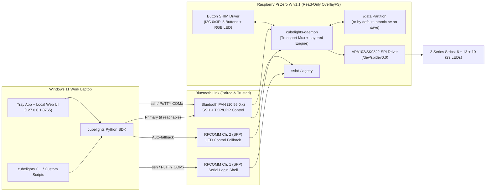

# Cubelights Technical Specification & Implementation Plan

## Goal Description
Recreate and modernize the cubicle RGB LED controller on a **Raspberry Pi Zero W v1.1** with a **Maniacal Labs PiPixel HAT**, **Pimoroni Button SHIM**, and **3 series-wired APA102/SK9822 strips (6 + 13 + 10 = 29 LEDs)**.

The system provides:
1. **Corruption-resilient Raspberry Pi OS setup** using read-only root (`OverlayFS`) and a normally-read-only `/data` partition with atomic remount-on-save writes so sudden cubicle power loss cannot corrupt the SD card, plus a repeatable golden SD card backup image workflow for fast restoration.
2. **Physical Button SHIM control** with configurable actions, status LED feedback, timed Bluetooth pairing mode, and safe shutdown.
3. **Hybrid Bluetooth connectivity** for a work laptop (Windows 11, no corporate Wi-Fi):
   - **Bluetooth PAN (NAP)** for native `ssh`, `scp`, and IP-based LED control/streaming.
   - **Bluetooth RFCOMM Serial Console** (virtual COM port) as a VPN/policy-proof maintenance shell fallback.
   - **Bluetooth RFCOMM LED Control Channel** speaking the exact same protocol as the IP transport so LED control works regardless of PAN/VPN policies.
4. **Layered, extensible LED engine** supporting:
   - Parameterized built-in shaders (`rainbow`, `pulse`, `wave`, `seasonal`, `warm_desk`, `sparkle`, `chase`, `gradient`, `solid`) mapped onto configurable 1D/2D segments (`6`, `13`, `10` LED zones with optional reversal and coordinates).
   - Uploadable declarative keyframe/palette animations stored on `/data` that run autonomously on the Pi.
   - Direct individual LED control (static per-LED/zone updates and high-speed binary frame streaming at 30–60 FPS).
   - Optional custom Python shaders loaded from `/data/shaders/`.
5. **Windows 11 client suite** (`cubelights` Python SDK, CLI, system tray app with Busy/On-Call toggle & Windows lock-screen integration, and a local web UI).

---

## Hardware & OS Constraints
- **Pi Model**: Raspberry Pi Zero W v1.1 (ARMv6 BCM2835). Must use **Raspberry Pi OS Lite (32-bit, Debian Bookworm)** — 64-bit images will not boot.
- **PiPixel HAT**: 2x3 jumper on **`SPI_DAT`** (`/dev/spidev0.0`, GPIO 10 MOSI + GPIO 11 SCLK). Supplies 5V power to both Pi and strips (up to 5A).
- **Button SHIM**: Connected on hardware I2C (`/dev/i2c-1`, address `0x3F`, GPIO 2 SDA + GPIO 3 SCL). Contains 5 tactile buttons (`A`–`E`) via TCA9554A and 1 onboard APA102 RGB LED.
- **LED Strips**: 3 APA102/SK9822 strips wired in series (6, 13, and 10 LEDs = 29 LEDs total). Configurable channel byte order (default `BGR`) and global brightness safety cap (default `0.75`).
- **Debug Serial**: Optional Adafruit PiUART on GPIO 14/15 (UART TX/RX), non-conflicting with SPI and I2C.
- **Filesystem Resilience & Backups**:
  - Root `/` protected by `OverlayFS` (runtime writes stay in `tmpfs` RAM).
  - Dedicated `/data` partition mounted `ro` by default and transiently remounted `rw` only during debounced atomic state/pattern saves.
  - Golden SD card backup image created after initial provisioning/testing for rapid restoration.

---

## Architecture Overview



---

## Repository Layout

```text
cubelights/
├── SPEC.md                      # This specification
├── README.md                    # Top-level guide and quick start
├── docs/                        # Comprehensive hardware, setup, Bluetooth, maintenance & protocol docs
├── shared/                      # Shared protocol, pattern schema, segment mapping (pure Python)
├── pi/                          # Raspberry Pi daemon, hardware drivers, systemd & provisioning scripts
├── client/                      # Windows 11 Python SDK, CLI, system tray, and local web UI
├── patterns/                    # Example declarative JSON keyframe & seasonal presets
└── tests/                       # Automated unit & integration tests
```

---

## Wire Protocol Summary
Dual-framing multiplexed stream over TCP (`7777`) or Bluetooth RFCOMM Channel 2 (plus optional UDP `7778` for low-latency binary frames):
- **JSON-line commands** (starts with `0x7B` `'{'`, terminated by `\n`):
  `hello`, `status`, `sync_time`, `set_mode`, `set_busy`, `set_power`, `set_brightness`, `set_leds`, `upload_pattern`, `delete_pattern`, `list_patterns`, `get_config`, `set_segment_map`, `set_color_order`, `ping`.
- **Compact Binary Frame packet** (starts with `0x01`):
  `[0x01][flags:1B][brightness:1B][payload_len:2B uint16 BE][RGB payload: N*3 bytes]` (92 bytes total for 29 LEDs).
